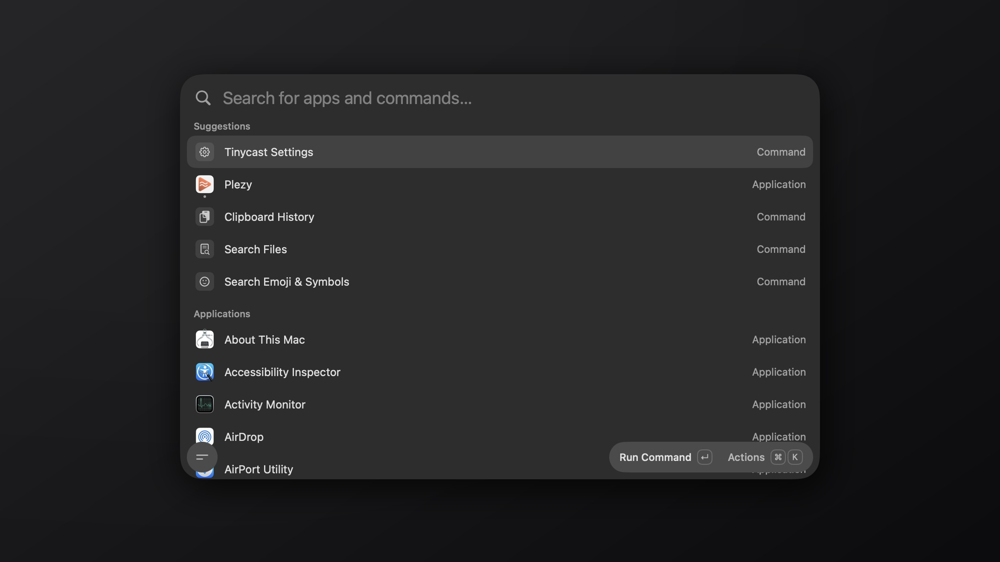

<h1 align="center">
  <a href="https://github.com/penguinstark/tinycast-legacy"></a><br>
  Tinycast Legacy
</h1>

<p align="center">
  A macOS 14.4 fork of Tinycast, the native launcher for everyday productivity.
</p>

<p align="center">
  <a href="#build"><strong>Build</strong></a> ·
  <a href="docs/README.md"><strong>Docs</strong></a> ·
  <a href="https://github.com/penguinstark/tinycast-legacy"><strong>Source</strong></a>
</p>

<p align="center">
  <br>
  <picture><source media="(prefers-color-scheme: dark)" srcset="https://shieldcn.dev/badge/MACOS-14.4%2B.svg?variant=ghost&amp;font=geist-mono&amp;mode=dark&amp;logo=apple" /></picture>
  <picture><source media="(prefers-color-scheme: dark)" srcset="https://shieldcn.dev/badge/SWIFT-6.svg?variant=ghost&amp;font=geist-mono&amp;mode=dark&amp;logo=swift&amp;valueColor=FB923C" /></picture>
  <a href="LICENSE"><picture><source media="(prefers-color-scheme: dark)" srcset="https://shieldcn.dev/badge/LICENSE-AGPL--3.0.svg?variant=ghost&amp;font=geist-mono&amp;mode=dark&amp;logo=lu:Scale" /></picture></a>
</p>

<p align="center">
  
</p>

Built with SwiftUI and AppKit. No dependencies, no Electron, no telemetry. It runs your Raycast
extensions, too.

Tinycast Legacy is a personal fork of [Tinycast](https://github.com/abue-ammar/tinycast) that targets
macOS 14.4. It does not track the upstream app, and it has no website, Discord, funding page or
release channel. The branch that builds on Xcode 16.2 is `xcode16-local`.

## Build

Requires macOS 14.4 or later and Xcode 16.2 with Swift 6.0.

```sh
git clone https://github.com/penguinstark/tinycast-legacy.git
cd tinycast-legacy
./Scripts/local-signing.sh   # once: a stable self-signed identity for local builds
open Tinycast.xcodeproj      # ⌘R
```

The Debug build is its own channel: `Tinycast Legacy Dev.app`, `com.tinycast.app.legacy.dev`. It keeps
its preferences, caches and permissions apart from the Release build.

There is no published download and no Homebrew cask for this fork. Build it locally, and install the
Release product wherever you keep your apps. Updates are whatever you build next.

More in [docs/development.md](docs/development.md) and [docs/testing.md](docs/testing.md).

## License

Tinycast Legacy is a fork of [Tinycast](https://github.com/abue-ammar/tinycast) by Md Abue Ammar,
licensed under the [AGPL-3.0 license](LICENSE). Third-party notices are in [NOTICE.md](NOTICE.md).
